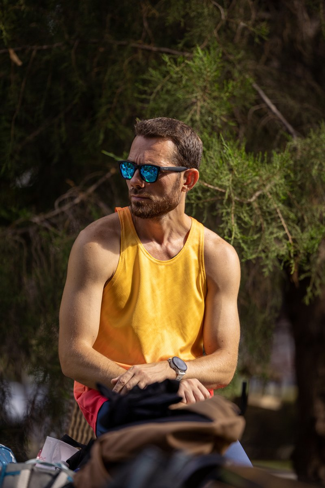

# Привет! Я Артём 👋

Начинающий **Python-разработчик** и специалист по **AI-автоматизации для логистики**.

Сейчас работаю в сфере логистики и занимаюсь отправкой посылок в разные города. Параллельно развиваюсь в IT и изучаю направление искусственного интеллекта, чтобы в дальнейшем перейти на удалённую работу в сфере Python и AI-инструментов.

## 🎓 Образование и навыки

В 2025 году окончил курс **«Python-разработчик»** в Нетологии. На курсе изучал основы Python, алгоритмы, работу с данными и принципы разработки программ.

Сейчас активно изучаю:
- нейросети и применение AI в реальных задачах
- автоматизацию рабочих процессов
- создание ботов и интеграций

Создаю практические проекты для портфолио, которые решают задачи из моего опыта в логистике.

## 💼 Проекты

### 📦 [delivery-helper](https://github.com/artemka87/delivery-helper)
Калькулятор стоимости и сроков доставки посылок на Python. Консольное приложение с автоматическими тестами и понятным README. Основан на реальных задачах из работы в логистике.

**Технологии:** Python, unittest

---

🔜 **В планах:** Telegram-бот с нейросетью для расчёта доставки, веб-интерфейс для калькулятора.

## 🏃 Вне работы

Занимаюсь **лёгкой атлетикой** и являюсь спортсменом-бегуном. Участвую в забегах на короткие и длинные дистанции, включая марафоны. Принимал участие в соревнованиях в Ростове, Ростовской области и других регионах, неоднократно занимал призовые места.

Также у меня есть опыт участия в съёмках: снимался в российских фильмах и сериалах в качестве актёра массовых сцен. За плечами около 15 картин и сериалов.

Спорт научил меня дисциплине, регулярной работе над собой и умению доводить начатое до конца. Сейчас я применяю эти качества в изучении программирования и искусственного интеллекта.

## 📫 Связаться со мной

- GitHub: [@artemka87](https://github.com/artemka87)
- Telegram: напишу, когда будет готов бот для портфолио 😉

---

💡 **Ищу возможности** для удалённой работы в сфере Python, AI-автоматизации или анализа данных. Готов учиться, брать задачи на фриланс и участвовать в проектах.
